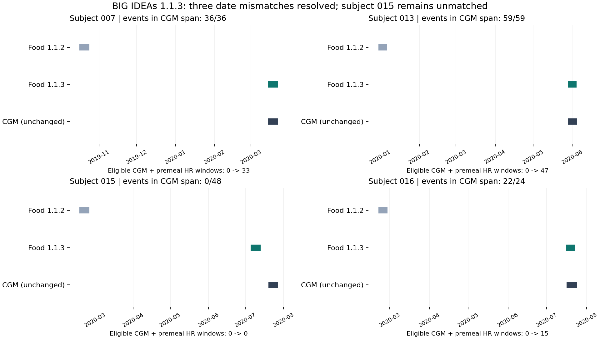

# BIG IDEAs 1.1.3 独立归档与饮食日期配对复核

状态日期：2026-11-09。状态：1.1.3 所选模态归档与四名受试者复核完成。旧版全部保留，训练语料、标签和划分未改。本次新增版本用于后续餐次分析的来源选择，不自动替换既有实验输入。

## 目标与执行结果

本次按用户授权，将 BIG IDEAs 的 CGM、腕带心率和饮食日志独立归档到 1.1.3，并复核 1.1.2 中饮食日期与 CGM 不重叠的 007、013、015、016。官方[版本说明](https://physionet.org/content/big-ideas-glycemic-wearable/1.1.3/#release-notes)说明本版修正了饮食日志日期；具体可用性以本地文件内容和固定配对规则重新计算。

新增归档包含 **49 个数据文件、251,228,403 字节**：16 份 Dexcom CGM、16 份 Empatica E4 HR、16 份饮食日志和一份人口学表。45 个文件与旧本地文件一致，经新版官方 SHA-256 核对后复制；仅 007、013、015、016 的四份饮食日志重新下载。另保存许可、官方哈希索引、来源页面与本地清单。下载范围延续结果数据优先的约定，未追加 ACC、BVP、EDA、TEMP 或 IBI。

**007、013、016 恢复了饮食与 CGM 的日期重叠，015 仍不重叠**。四人的源文件均保持官方原样，没有通过血糖曲线、最大化重叠或手工平移推断日期。

## 版本差异与旧数据保护

| 检查项 | 结果 | 证据 |
|---|---|---|
| 官方文件索引比较 | 两版各 130 项，只有四份饮食日志的哈希变化；CGM 与 HR 均未变化 | [official_version_diff.json](audits/bigideas_1_1_3_2026-11-09/official_version_diff.json) |
| 新归档数据文件 | 49 / 49 与新版官方 SHA-256 一致；45 份复制、4 份新下载 | [source_manifest.json](audits/bigideas_1_1_3_2026-11-09/source_manifest.json) |
| 关键旧文件保护 | 101 / 101 未变化，无缺失 | [preservation_check.json](audits/bigideas_1_1_3_2026-11-09/preservation_check.json) |
| 既有清单全量保护 | 17,867 / 17,867 原文件未变化 | [inventory_preservation_check.json](audits/bigideas_1_1_3_2026-11-09/inventory_preservation_check.json) |

130 项是官方发布索引的比较范围，并不表示本次下载了完整多模态发布包。49 个数据文件的字节数也不包括另存的说明、来源凭证和审计产物。校验以 HTTPS 获取的官方 SHA-256 清单为依据；该清单没有额外的独立签名。

四份新饮食日志与旧版按原 CSV 行位置比较，行数未变化。六项营养字段的数值保持一致，但部分数值的文本表示发生变化，不能将整份文件概括为逐字节只改日期。配对使用正式命名的 `time_begin`；独立解析同时确认四人的该字段均与分开的日期和时刻字段相符。详细字段差异见[四人直接源文件复核](audits/bigideas_1_1_3_2026-11-09/four_subject_source_check.json)。

## 四名受试者的时间范围与配对结果



图源：本地官方 1.1.2 与 1.1.3 CSV 的实际时间范围；各文件哈希见来源清单。

图中每个面板对应一名受试者，横轴是来源文件已发布的日期，纵向分别显示 1.1.2 饮食、1.1.3 饮食和 CGM 三条时间范围。条带连接各文件的首末有效时间；它不是连续佩戴覆盖，也没有表达条带内部的缺测、食物记录密度或血糖数值。CGM 两版字节一致，因此只需一条 CGM 参照。这里的日期是去标识化后发布的日期，不能还原为受试者真实生活日历。

| 受试者 | 1.1.2 饮食日期 | 1.1.3 饮食日期 | CGM 日期 | 新版进食事件 | 落入 CGM 首末时间范围 | 合格 CGM + 餐前 HR 窗口 |
|---|---|---|---|---:|---:|---:|
| 007 | 2019-10-16 至 2019-10-24 | 2020-03-14 至 2020-03-22 | 2020-03-14 至 2020-03-22 | 36 | 36 | 33 |
| 013 | 2019-12-30 至 2020-01-06 | 2020-05-28 至 2020-06-04 | 2020-05-28 至 2020-06-04 | 59 | 59 | 47 |
| 015 | 2020-02-17 至 2020-02-25 | 2020-07-05 至 2020-07-13 | 2020-07-19 至 2020-07-27 | 48 | 0 | 0 |
| 016 | 2020-02-21 至 2020-02-28 | 2020-07-16 至 2020-07-23 | 2020-07-16 至 2020-07-24 | 24 | 22 | 15 |

007 和 013 的新版饮食条带与 CGM 首末时间范围重叠，分别有 36 和 59 个进食事件落入该范围。进一步要求餐前、餐后 CGM 覆盖和餐前 HR 覆盖后，分别保留 33 和 47 个窗口。首末日期相交只建立候选资格，不能替代逐窗口检查。

016 的新版饮食时间范围也与 CGM 相交，但其第一天饮食开始于 06:30，CGM 首点为 10:43:25，所以 24 个事件中仅 22 个落入 CGM 首末时间范围；最终 15 个满足完整窗口条件。图上同日开始的条带在日历尺度看似一致，不等于同一时刻启动采集。

015 的新版饮食结束于 2020-07-13 07:30，CGM 开始于 2020-07-19 17:33:52，仍有超过六天的空档。其 HR 时间范围为 2020-07-05 至 2020-07-25，可以分别与部分饮食和部分 CGM 相交，但这不能组成同一餐的 CGM、饮食、HR 三方配对。48 个事件继续排除在餐后窗口之外。未把新版饮食再次平移，也未据此判断具体哪个设备或日期字段有错。

这张图及上述变化反映的是数据时间对应关系的修订，不能解释为血糖生理响应改善、可穿戴预测能力增强或模型性能提高。本次没有训练模型，也没有比较预测误差或因果效应。

## 固定规则下的总体变化

两版使用相同的事件聚合、CGM 覆盖和餐前 HR 条件。CGM 与 HR 源文件不变，因此 36,898 个 CGM 点、9,384,435 行 HR，以及共同占格折算的 2,413.25 人小时保持不变；共同占格占 CGM 占格的 78.52%。该时长是五分钟共同占格数除以 12，不是连续无缺口的佩戴时长。

| 指标 | 1.1.2 | 1.1.3 | 变化 |
|---|---:|---:|---:|
| 食物记录行 | 1,422 | 1,422 | 0 |
| 按同人、同开始时刻聚合的进食事件 | 735 | 735 | 0 |
| 落入 CGM 首末时间范围的事件 | 556 | 673 | +117 |
| 餐前及餐后 CGM 窗口合格 | 542 | 657 | +115 |
| CGM + 餐前 HR 窗口合格 | 431（12 人） | 526（15 人） | +95，+3 人 |
| 上项且四项营养完整 | 352（11 人） | 447（14 人） | +95，+3 人 |
| 合格窗口且后 120 分钟无下一条已记录进食 | 276（12 人） | 332（15 人） | +56 |
| 相邻 30 分钟聚合敏感性下的合格窗口 | 388 | 465 | +77 |

新增 95 个 CGM + 餐前 HR 窗口恰好来自 007、013、016，分别增加 33、47、15 个。735 个进食事件总量和 627 个营养完整事件总量均未变化；447 个是营养完整事件与时间窗口条件的交集，不是新增了 95 条饮食记录。统计分别见[新版配对汇总](audits/bigideas_1_1_3_2026-11-09/pairing_summary.json)、[营养完整性](audits/bigideas_1_1_3_2026-11-09/pairing/bigideas/nutrition_completeness.json)与[逐人结果](audits/bigideas_1_1_3_2026-11-09/pairing/bigideas/per_subject.csv)；旧版证据保留于[1.1.2 汇总快照](audits/bigideas_1_1_3_2026-11-09/baseline_1_1_2_summary.json)。

窗口要求为：餐前 `[-30,0)` 分钟和餐后 `[0,120)` 分钟的原生五分钟 CGM 点数分别达到预期的至少 80%，含边界最大缺口不超过 20 分钟；餐前六个完整五分钟格中至少五格有合格 HR。HR 的 30–220 bpm 范围仅用于本次合理性筛查；仅要求 HR 为正值的敏感性结果仍是 526 个窗口。非整格餐时只使用其之前的完整 HR 时间格，不混入餐后 HR。

## 保留的数据边界与决策

- **015 继续不进入餐后候选**：即使新版饮食日期有修订，仍按实际内容判定。后续如需使用，应取得官方进一步修订或可核实的时间映射，不能根据血糖形状猜测偏移。
- **003 的无表头格式仍保留**：58 行、11 列，第三列时刻与前两列日期加时间在 58 / 58 行一致，因此可确定进食时点；未将未知营养列套用为其他人的 14 列定义。003 不进入营养完整子集。
- **012 的一条缺失开始时间仍不补入主分析**：用其显式日期和时刻重建的敏感性结果是 736 个事件、527 个合格窗口，较主口径各多一个；源文件未改。
- **发布时钟不等于绝对同步证明**：原 CSV 没有充分的 UTC 偏移、设备校准和夏令时转换元数据。001 的 HR 只保留分钟精度，其他人有秒级记录，不宣称全体逐秒精确对齐。
- **进食事件不等于确认的一顿正餐**：食物行按同人同开始时刻合并，仍可能包含加餐、饮料和漏记。后两小时没有下一条日志也不排除漏记或餐前残余效应；旧字段名 `isolated_*` 只表示这项日志筛查。
- **候选窗口不是自动训练输入**：餐后 CGM 仅用于标签覆盖筛查。餐时预测须限定输入可获得时间，不能使用餐后 HR、活动或未来 CGM。四项营养完整只表示热量、碳水、蛋白和脂肪字段非负且非缺失，不证明营养记录准确；本次未接入新训练或改变受试者划分。

## 产物与复现

本提交仅包含方法代码、报告、汇总统计及文件校验记录。原始 CSV、下载包、逐餐事件表和具体缺失时间恢复记录均保留本地。公开配对汇总将缺失时间恢复明细替换为数量，其余聚合统计沿用本地审计结果。以下复现命令要求本地已有 1.1.2 源数据及其来源清单。

| 用途 | 项目内路径 |
|---|---|
| 新版独立数据归档（仅本地） | `datasets/BIG_IDEAs/1.1.3/results/` |
| 新版来源及逐文件哈希清单 | [source_manifest.json](audits/bigideas_1_1_3_2026-11-09/source_manifest.json) |
| 官方页面、许可与哈希索引（仅本地） | `datasets/BIG_IDEAs/1.1.3/results/metadata/` |
| 版本比较、旧文件保护和四人直接复核 | [本次审计目录](audits/bigideas_1_1_3_2026-11-09/) |
| 新版配对与营养汇总 | [配对汇总](audits/bigideas_1_1_3_2026-11-09/pairing_summary.json)；逐餐事件表仅保留本地 |
| 原版归档与证据 | 本地 `datasets/BIG_IDEAs/1.1.2/results/`；[1.1.2 汇总](audits/bigideas_1_1_3_2026-11-09/baseline_1_1_2_summary.json) |
| 本数据集版本登记 | [BIG IDEAs 元数据快照](audits/bigideas_1_1_3_2026-11-09/catalog_entry.json)；完整 `data_catalog/` 保留本地 |

以下命令在 `C:\Coding\Work\CGM_FM` 执行，使用项目已有的 `uv` 管理环境。归档脚本按官方清单验证复用文件和新下载文件，并保留旧版；配对脚本显式指定新清单和新的输出位置，避免覆盖旧版配对结果。

```powershell
[Console]::OutputEncoding = [System.Text.Encoding]::UTF8
$env:PYTHONIOENCODING = "utf-8"
$env:PYTHONUTF8 = "1"
.\.venv-data\Scripts\python.exe scripts\upgrade_bigideas_113.py --root .
.\.venv-data\Scripts\python.exe scripts\audit_pairing_but_big.py --dataset bigideas --bigideas-manifest datasets/BIG_IDEAs/1.1.3/results/source_manifest.json --output-dir reports/audits/bigideas_1_1_3_2026-11-09/pairing
.\.venv-data\Scripts\python.exe scripts\check_four_subject_sources.py
```

仅检查归档文件是否仍与已保存官方哈希一致，可运行下列只读命令；它不会下载或重建数据：

```powershell
.\.venv-data\Scripts\python.exe -c "import json,hashlib,pathlib; r=pathlib.Path('.'); m=json.loads((r/'datasets/BIG_IDEAs/1.1.3/results/source_manifest.json').read_text(encoding='utf-8')); bad=[x['local_path'] for x in m['files'] if not (r/x['local_path']).is_file() or hashlib.file_digest((r/x['local_path']).open('rb'),'sha256').hexdigest()!=x['official_sha256']]; print({'checked':len(m['files']),'mismatches':bad}); assert not bad"
```

配对复现仍沿用已有规则和共用实现 [audit_multimodal_common.py](../scripts/audit_multimodal_common.py)。复现时应同时记录版本清单、事件定义、窗口覆盖阈值及营养完整口径；不能只记录“使用 BIG IDEAs”，也不能用本次 526 或 447 的候选数替换历史实验所用样本数。
